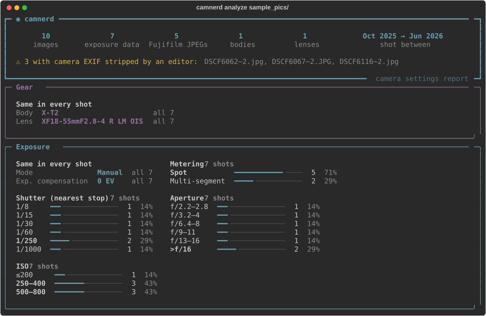
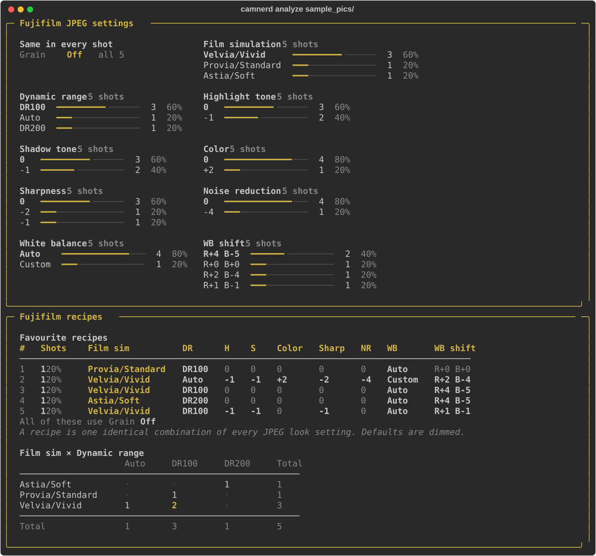
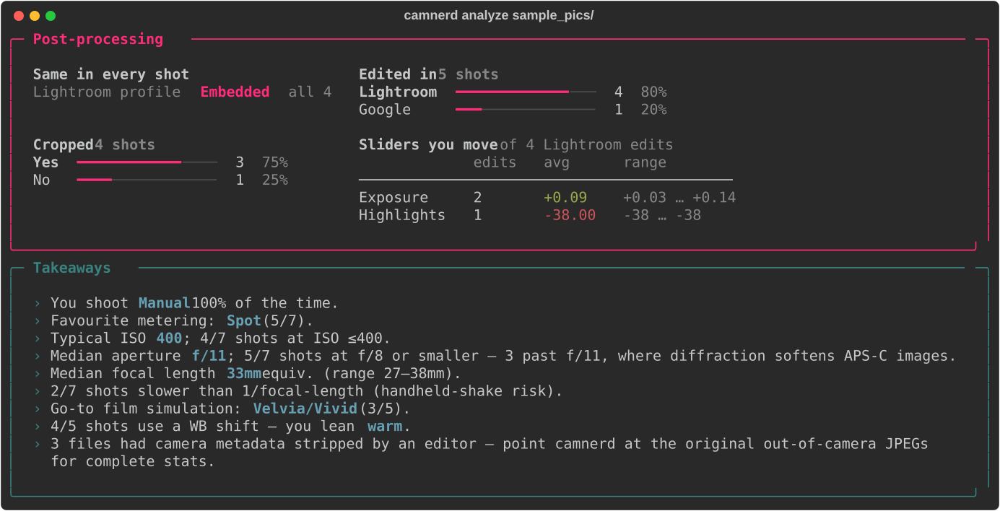

# camnerd

Extract camera metadata from your photos and find out what settings you actually shoot with.

camnerd reads EXIF, XMP and Fujifilm maker notes from JPEGs, then prints a terminal report of your most frequent settings: gear, exposure, framing, time of day, Fujifilm film-simulation "recipes", and Lightroom edits.



## Install

Requires Python 3.13+ and [uv](https://docs.astral.sh/uv/).

```sh
uv sync
uv run camnerd --help
```

Or install it as a tool: `uv tool install .`

## Usage

### Analyze

Print a report for a folder of JPEGs (subfolders are included by default):

```sh
uv run camnerd analyze sample_pics/
uv run camnerd analyze ~/Pictures/2025 --top 12 --no-recursive
```

The report covers:

- **Gear**: camera bodies and lenses
- **Exposure**: mode, metering, shutter speed (snapped to the nearest full stop), aperture, ISO, exposure compensation, summary stats and common exposure triangles
- **Framing and timing**: focal length (35mm equivalent), time of day, month
- **Fujifilm JPEG settings**: film simulation, dynamic range, tone, color, grain, color chrome, white balance and WB shift; favourite full recipes; a film sim × dynamic range crosstab
- **Focus and drive**: focus mode, AF area, drive mode, shutter type, IS
- **Post-processing**: the editing software used, Lightroom profiles, crops, and which develop sliders you move
- **Takeaways**: a short plain-English summary of your habits

Settings that never change across your shots are collapsed into a compact "Same in every shot" list, so the bar charts only show the choices you actually vary.





Save the report as an image or web page with `--save`:

```sh
uv run camnerd analyze sample_pics/ --save report.svg   # also .html or .txt
```

The screenshots above are generated from `sample_pics/` with `uv run python docs/screenshots.py`.

### Extract

Dump per-image metadata to CSV or JSON:

```sh
uv run camnerd extract sample_pics/ -o metadata.csv
uv run camnerd extract sample_pics/ -o metadata.json --show   # also print each file
```

`analyze` also accepts a file written by `extract`, so you can scan a large library once and re-run the report quickly:

```sh
uv run camnerd analyze metadata.csv
```

## Notes

- Only `.jpg` / `.jpeg` files are scanned. RAW files are not supported.
- Fujifilm settings are decoded from the maker notes (tables adapted from ExifTool's `FujiFilm.pm`), so they are only available on out-of-camera Fujifilm JPEGs.
- Editors often strip EXIF on export. camnerd falls back to XMP where it can and flags files with missing exposure data; point it at the original JPEGs for complete stats.
